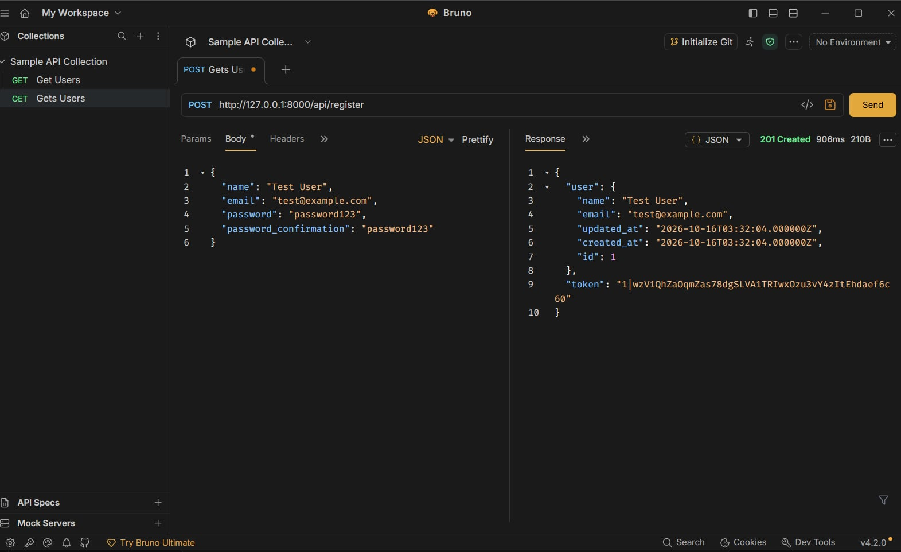
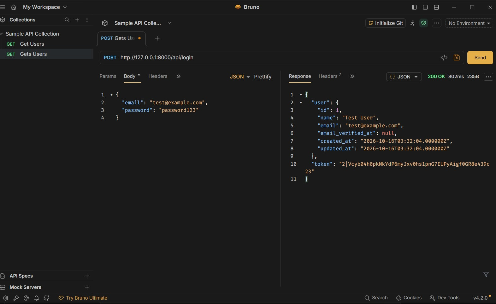
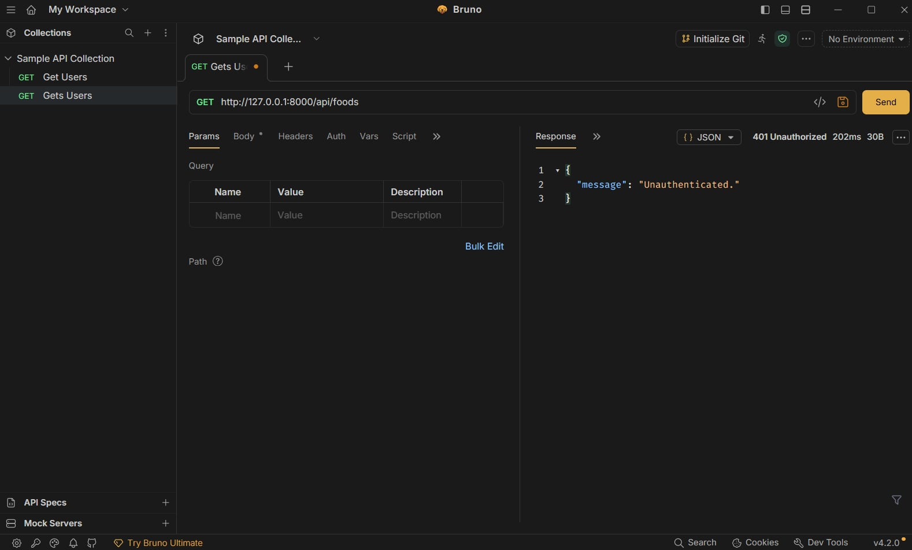
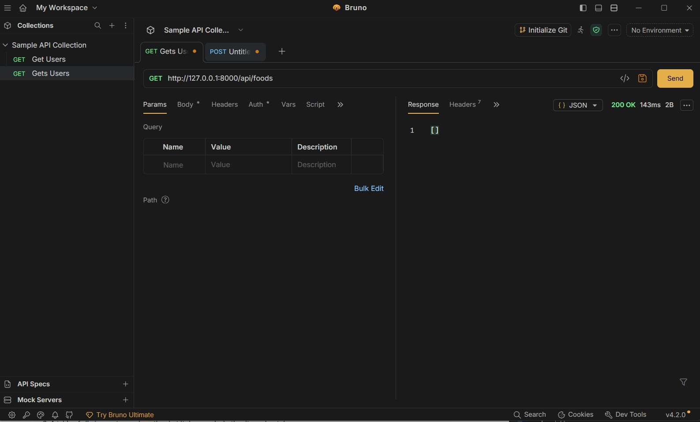
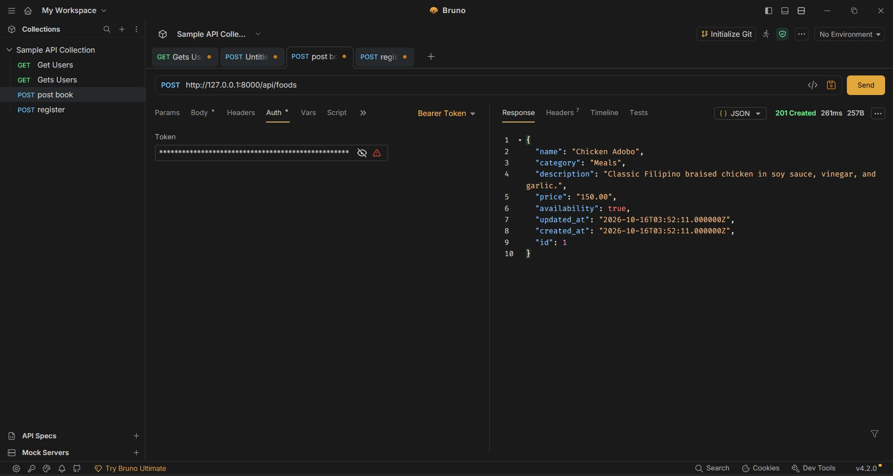
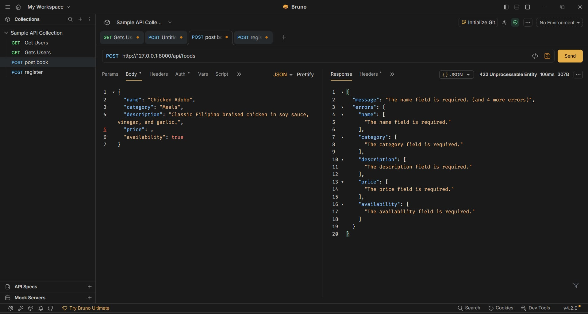
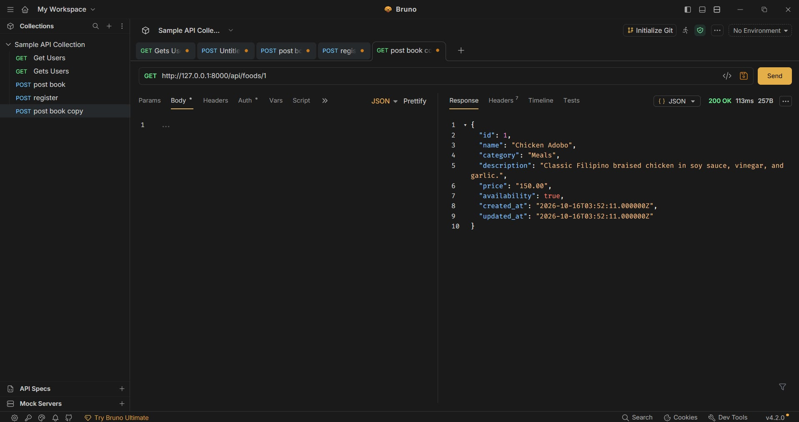
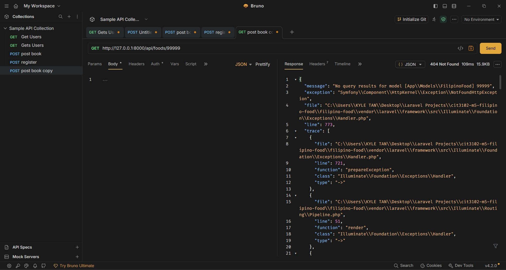
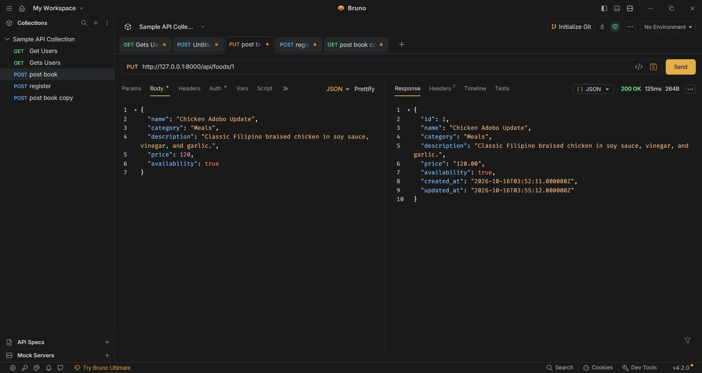
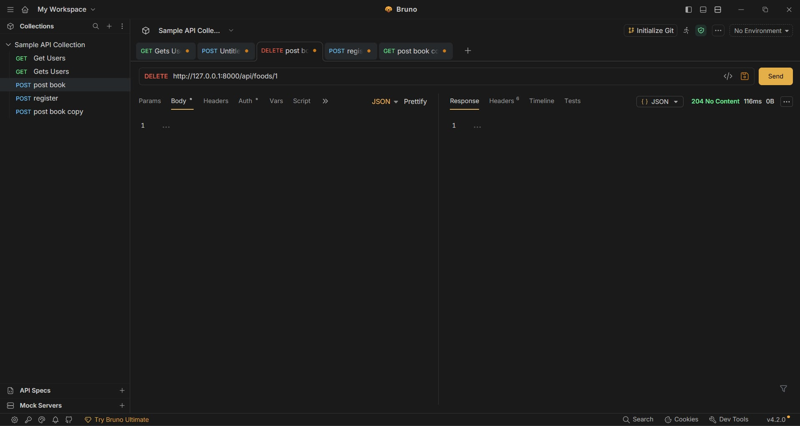

# Filipino Food Menu API

**Project Title:** Build Your Own API – Filipino Food Menu API

**Partners:** Kyle Tan and Jaira Zarzoso

**Section:** IT2E

**Resource:** Filipino Food Menu

## Setup Instructions

Requirements: PHP, Composer, Git, and Bruno.

1. Clone the repository:

   `git clone YOUR_GITHUB_REPOSITORY_URL`

2. Open the project folder: 

   `cd cit3102-m5-filipino-food`

3. Enter the Laravel app folder:

   `cd filipino-food`

4. Install dependencies:

   `composer install`

5. Create the environment file on Windows:

   `copy .env.example .env`

6. Generate the application key:

   `php artisan key:generate`

7. Configure SQLite in `.env` and make sure `database/database.sqlite` exists. If it does not exist, create it first:

   `type nul > database\database.sqlite`

8. Run migrations:

   `php artisan migrate`

9. Start the server:

   `php artisan serve`

10. Set the Bruno base URL to `http://127.0.0.1:8000`.

11. Register and log in to obtain a token for protected routes.

## API Routes

| Method | Path | Description | Needs Token? |
|---|---|---|---|
| POST | `/api/register` | Register a user | No |
| POST | `/api/login` | Log in and get a token | No |
| POST | `/api/logout` | Log out | Yes |
| GET | `/api/me` | View user information | Yes |
| GET | `/api/foods` | List and filter menu items | Yes |
| POST | `/api/foods` | Add a food item | Yes |
| GET | `/api/foods/{food}` | View one food item | Yes |
| PUT | `/api/foods/{food}` | Update a food item | Yes |
| DELETE | `/api/foods/{food}` | Delete a food item | Yes |

## Bruno Test Screenshots

Insert the actual screenshots from Step 6 in this section.

1. Register a new user — 201 Created
   
2. Login with that user — 200 OK
   
3. Get foods without a token — 401 Unauthorized
   
4. Get foods with a token — 200 OK
   
5. Create a food item — 201 Created
   
6. Create a food item with a required field missing — 422 Unprocessable Content
   
7. Get an existing food item — 200 OK
   
8. Get a nonexistent food item — 404 Not Found
   
9. Update an existing food item — 200 OK
   
10. Delete a food item — 204 No Content
   

## Why Does DELETE Return 204 Instead of 200?

The HTTP status code 204 means that the request was successful and there is no response content to return. When a food item is deleted, the API removes the record from the database and sends an empty response. A 200 status code can also indicate success, but it is commonly used when the server returns a response body. The 204 status code is appropriate when the deletion succeeds without returning additional information.
